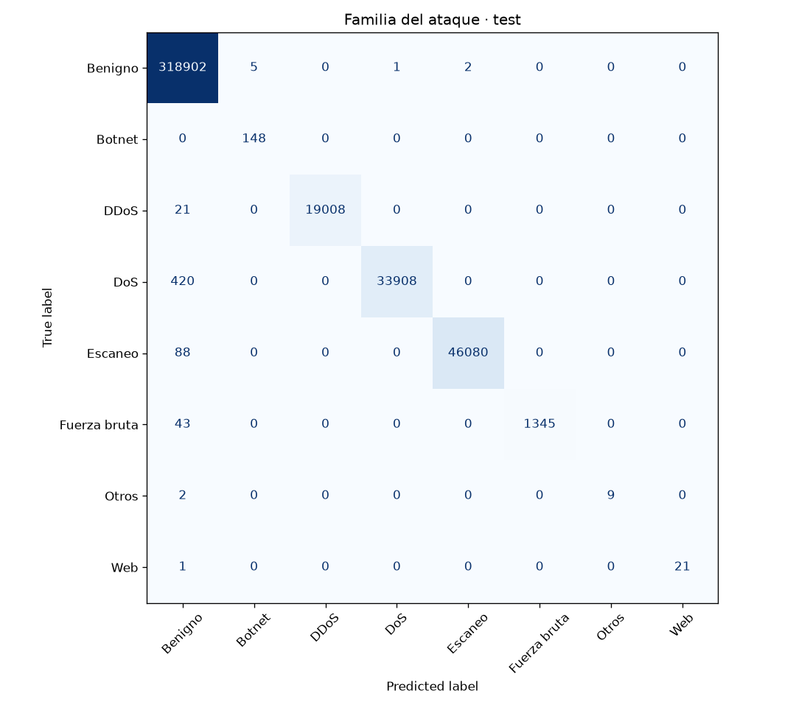
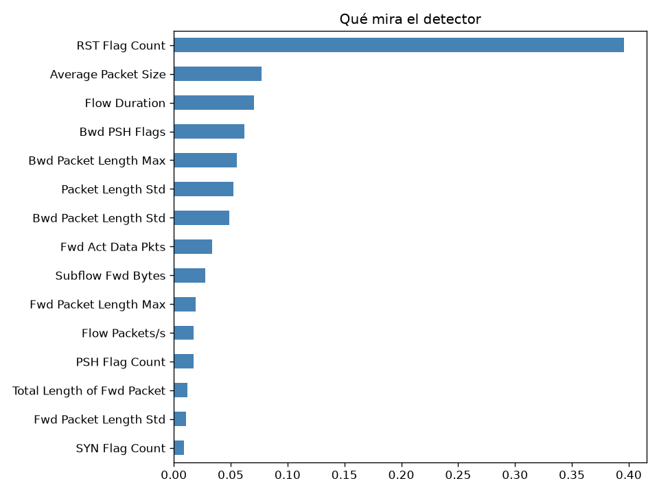

# IntrusionDetectionML

Un detector de intrusiones de red con **XGBoost**, entrenado sobre la versión **corregida** de
CIC-IDS2017 y evaluado como se usaría de verdad: separando entrenamiento y prueba por tiempo, sin
columnas que delaten la respuesta y mirando la nota de prueba una sola vez.

Mayo de 2026.

## Resultado

**Detección (ataque o tráfico normal)**, sobre 420.004 flujos de prueba que el modelo no ha visto
(101.094 de ataque y 318.910 normales), con «ataque» como clase positiva:

| | Predicho: ataque | Predicho: normal |
|---|---:|---:|
| **Real: ataque** | VP **100.519** | FN **575** |
| **Real: normal** | FP **8** | VN **318.902** |

| Métrica | Cálculo | Valor |
|---|---|---:|
| Tasa de detección (recall, TPR) | VP / (VP + FN) | **99,43 %** |
| Tasa de falsos negativos (FNR) | FN / (VP + FN) | 0,57 % |
| Tasa de falsos positivos (FPR) | FP / (FP + VN) | **0,0025 %** |
| Precisión | VP / (VP + FP) | 99,99 % |
| F1 | 2·VP / (2·VP + FP + FN) | 0,997 |

**Familia del ataque**, con F1 macro de **0,98**:

| Familia | F1 | Flujos de prueba |
|---|---:|---:|
| Benigno | 0,999 | 318.910 |
| DDoS | 0,999 | 19.029 |
| Escaneo | 0,999 | 46.168 |
| DoS | 0,994 | 34.328 |
| Botnet | 0,983 | 148 |
| Fuerza bruta (FTP, SSH) | 0,984 | 1.388 |
| Web (fuerza bruta, XSS, inyección SQL) | 0,977 | 22 |
| Otros (Heartbleed, infiltración) | 0,900 | 11 |



Ninguna familia se confunde con otra: los errores son todos ataques que pasan por tráfico normal, o al
revés.

### Dónde falla

De los 575 falsos negativos, 420 son de dos ataques:

| Ataque | Flujos de prueba | Falsos negativos | Detectado |
|---|---:|---:|---:|
| **DoS Slowloris** | 772 | **254** | 67,1 % |
| **DoS Slowhttptest** | 348 | **166** | 52,3 % |
| Portscan | 31.814 | 88 | 99,7 % |
| SSH-Patator | 593 | 33 | 94,4 % |
| DDoS | 19.029 | 21 | 99,9 % |
| FTP-Patator | 795 | 10 | 98,7 % |
| Heartbleed, infiltración, inyección SQL | 14 | 3 | — |
| DoS Hulk, GoldenEye, botnet, escaneo interno, web (fuerza bruta y XSS) | 47.729 | 0 | 100 % |

Los dos DoS «lentos» son el punto débil, y tiene sentido: su gracia es abrir conexiones y mandar datos
con cuentagotas para que parezcan clientes lentos legítimos. Visto flujo a flujo, muchos son
indistinguibles de una conexión normal que espera. Para pillarlos hace falta mirar el conjunto (muchas
conexiones medio abiertas contra el mismo servidor), no cada flujo por separado.

Lo que más pesa en la decisión es `RST Flag Count`, que es comportamiento puro: un escaneo provoca
respuestas RST de los puertos cerrados y muchos DoS cortan conexiones a la fuerza. La huella de la
máquina atacante (la ventana TCP inicial) no aparece entre lo que más mira.



## Cómo está hecho

- **Datos:** [CIC-IDS2017 corregido](https://intrusion-detection.distrinet-research.be/CNS2022/) por
  DistriNet (KU Leuven). Regeneraron los flujos desde las capturas originales y arreglaron el extractor
  y el etiquetado. 2.099.971 flujos en cinco días. Los flujos «Attempted» (ataques que en la práctica no
  hicieron nada malicioso) cuentan como benignos, como recomiendan sus autores.
- **Fuera del modelo:** IPs, puertos, ID del flujo y marca de tiempo. El modelo tiene que reconocer cómo
  se comporta un flujo, no a quién va dirigido.
- **División por tiempo:** cada tipo de ataque, en orden cronológico, se parte en 60 % entrenamiento,
  20 % validación y 20 % prueba (el tráfico normal, igual, día a día). El modelo ve el principio de
  cada ataque y tiene que reconocer el final.
- **Sin ajustar contra la prueba:** cuatro candidatos para detectar y dos para clasificar, elegidos solo
  con la validación. El ganador se reentrena con el 80 % y se mide en la prueba una vez.
- **Modelo:** `XGBClassifier(n_estimators=300, max_depth=8, learning_rate=0.1)`. El elegido fue el
  clasificador de familias sin pesos de clase, leído como «ataque si no es benigno».

## Límites

- Es tráfico de laboratorio. En una red real el tráfico normal es más variado y habría que reentrenar
  con el suyo.
- Detecta ataques **parecidos a los que ha visto**. Un tipo de ataque nuevo no está medido.
- Las clases diminutas (Heartbleed: 3 flujos de prueba, inyección SQL: 3, infiltración: 8) no permiten
  concluir nada.
- Es una sola semilla.

## La primera versión, y por qué la rehíce

La primera versión de este repositorio daba una exactitud de 0,9999 sobre otra variante de
CIC-IDS2017. Al revisarla encontré tres problemas: una columna `Counter` (el número de fila) usada como
característica, flujos duplicados entre entrenamiento y prueba, y una división aleatoria que dejaba en
la prueba flujos casi idénticos a los de entrenamiento. Quitándolos, el F1 macro bajaba de 0,984 a
0,846, y ninguna mejora del modelo lo arreglaba: buena parte del problema estaba en los datos, que
tienen errores de etiquetado documentados. Por eso cambié a la versión corregida.

Todo ese recorrido, con sus scripts y resultados, está en [`anterior/`](anterior).

## Reproducirlo

```bash
# datos (343 MB)
curl -LO https://intrusion-detection.distrinet-research.be/CNS2022/Datasets/CICIDS2017_improved.zip
unzip CICIDS2017_improved.zip -d datos/

docker build -t ids-lab .
docker run --rm --network none --user "$(id -u):$(id -g)" \
  -v "$PWD":/src -v "$PWD/datos":/data:ro -w /src ids-lab \
  python src/detector.py --datos /data --hilos 8
```

Tarda unos 7 minutos con 8 hilos y deja las métricas, la matriz y las importancias en
`results/detector/`. Con `--muestra 0.03` hace una prueba rápida con el 3 % de los datos.
