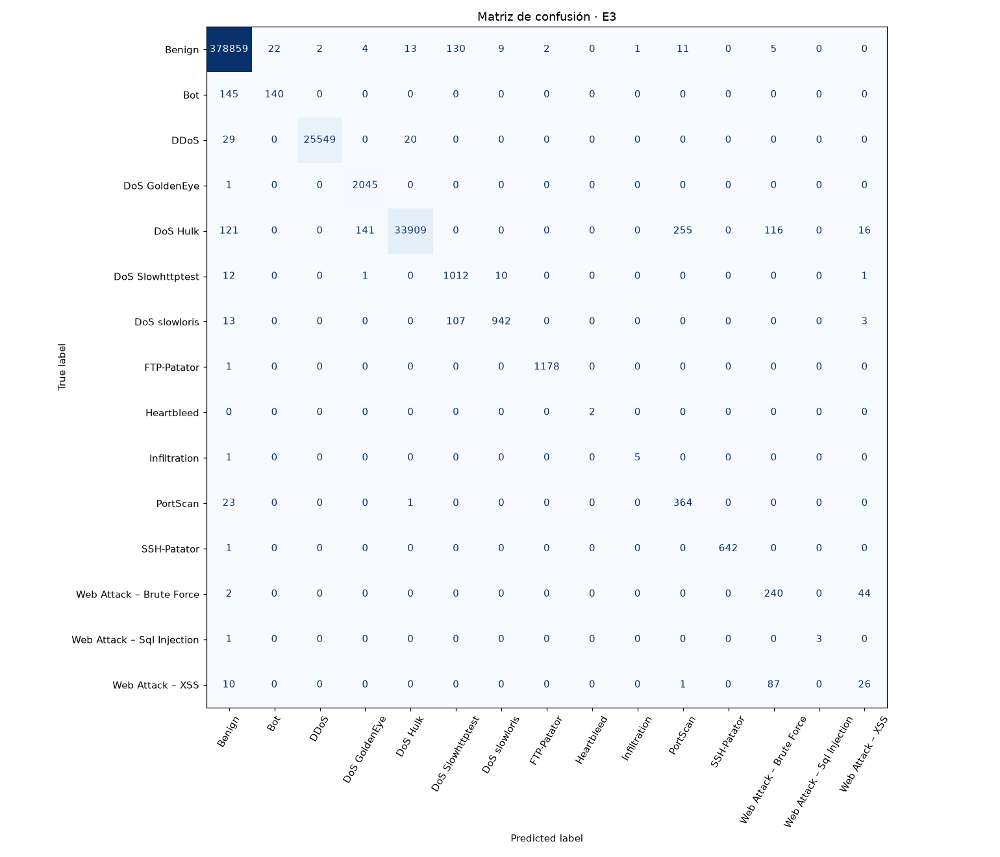

# IntrusionDetectionML

Un clasificador de tráfico malicioso (**XGBoost**, un Gradient Boosted Tree) entrenado sobre
CIC-IDS2017 para distinguir 15 clases: benigno, botnet, DDoS, cuatro variantes de DoS, fuerza bruta
FTP y SSH, Heartbleed, infiltración, escaneo de puertos y tres ataques web (fuerza bruta, inyección
SQL y XSS).

Noviembre de 2026.

La primera versión de este repositorio presumía de una exactitud de 0,9999. Un resultado así sobre
CIC-IDS2017 es casi siempre una señal de alarma, no de éxito, así que lo he rehecho midiendo cuánto
de esa nota es fuga de datos. El resultado honesto es un **F1 macro de 0,846**, no de 0,99.

## Resultados

El mismo modelo (`n_estimators=200, max_depth=6, learning_rate=0.1`) evaluado de cuatro maneras, cada
una quitando una fuente de fuga más:

| Experimento | Qué cambia |
|---|---|
| **E0** | el planteamiento original: todas las columnas, división aleatoria 80/20 |
| **E1** | sin `Counter`, que es el número de fila dentro de cada fichero diario y no una característica de red |
| **E2** | E1 y sin los flujos duplicados (82.004, un 3,5 %) |
| **E3** | E2 y división por **bloques contiguos** dentro de cada clase, en lugar de aleatoria |
| **E0c** | control: el modelo solo ve `Counter` |

| Experimento | Flujos de test | Exactitud | F1 macro |
|---|---:|---:|---:|
| E0 | 462.762 | 0,9998 | **0,9841** |
| E1 | 462.762 | 0,9989 | 0,8767 |
| E2 | 446.362 | 0,9988 | 0,8653 |
| E3 | 446.278 | 0,9969 | **0,8464** |
| E0c | 462.762 | 0,8546 | 0,0614 |

F1 por clase, las que se mueven (las demás, como DDoS, FTP-Patator, SSH-Patator o el tráfico benigno,
se quedan en torno a 1,0 en los cuatro). La tabla completa está en
[`results/comparacion.md`](results/comparacion.md).

| Clase | E0 | E1 | E2 | E3 |
|---|---:|---:|---:|---:|
| Web Attack – XSS | 0,972 | 0,363 | 0,330 | 0,243 |
| Web Attack – Brute Force | 0,991 | 0,785 | 0,772 | 0,654 |
| Bot | 0,979 | 0,746 | 0,731 | 0,626 |
| PortScan | 0,997 | 0,931 | 0,938 | 0,714 |
| DoS Slowhttptest | 0,997 | 0,964 | 0,967 | 0,886 |



## Qué dicen los números

- **La exactitud engaña.** El 85 % de los flujos son benignos: un modelo que dijera «benigno» a todo ya
  saca 0,8546, que es justo lo que da el control E0c. Por eso miro el F1 macro, que pesa igual a las 15
  clases.
- **Quitar `Counter` es lo que más baja la nota** (de 0,984 a 0,877), y casi solo en las clases con pocas
  muestras. El control demuestra que `Counter` por sí sola no sirve de nada (predice «benigno» siempre).
  Mi hipótesis, sin demostrar, es que sirve de desempate temporal entre clases casi idénticas: en la
  matriz se ve que 87 de los 124 XSS se confunden con fuerza bruta web, que a nivel de flujo son
  prácticamente lo mismo.
- **Los duplicados restan poco** (−0,011) y **la división por bloques algo más** (−0,019), sobre todo en
  PortScan (0,997 → 0,714): los flujos vecinos en el tiempo se parecen tanto que, mezclados al azar, el
  test casi es una copia del entrenamiento.
- Entre los duplicados hay **270 filas con exactamente las mismas características y distinta etiqueta**.
  Ningún modelo puede acertar las dos.

## Limitaciones

- **Heartbleed (2 flujos de test), inyección SQL (4) e infiltración (6) son demasiado pocos** para
  concluir nada: su F1 es ruido.
- Es **una sola semilla** (`random_state=42`). Para las clases pequeñas, el F1 puede moverse bastante
  entre ejecuciones.
- E2 y E3 usan un conjunto de test distinto al de E0 y E1 (sin duplicados), así que la comparación no es
  perfecta.
- La división por bloques es mejor que la aleatoria, pero **no equivale a separar por días**, que sería
  la prueba más exigente: el CSV no trae marca de tiempo, solo el orden de las filas.
- No he vuelto a aplicar el modelo a una captura de tráfico propia, como hacía la primera versión.

## Sobre la versión anterior

Los resultados publicados antes (exactitud 0,9999, F1 macro 0,9918, con una columna `Destination Port`
como característica más importante) **no se pueden reproducir con el CSV que uso ahora**: tiene 2.313.810
flujos, otras columnas (no trae `Destination Port`) y otro reparto de clases. Debieron de salir de otra
versión del dataset, que ya no tengo a mano. Los he retirado, igual que la matriz, las importancias y las predicciones
sobre la captura, y los sustituyo por los de arriba, que sí se generan con el código de este repositorio.

## Reproducirlo

El dataset no está en el repositorio (son 783 MB). El script espera un CSV de CIC-IDS2017 con una columna
`Label`; el que uso es una versión fusionada de 2.313.810 flujos, con 77 características de CICFlowMeter,
`Counter` y `Label`. Con otra versión (por ejemplo, la clásica con `Destination Port`) los números serán
otros.

Todo va en Docker, sin red:

```bash
docker build -t ids-lab .
docker run --rm --network none --user "$(id -u):$(id -g)" \
  -v "$PWD":/src -v /ruta/a/cicids2017.csv:/data/cicids2017.csv:ro -w /src ids-lab \
  python src/train_gbt_cicids2017.py E3 --csv /data/cicids2017.csv --hilos 8
```

Cambia `E3` por `E0`, `E1`, `E2` o `E0c`. Cada experimento tarda unos tres minutos con 8 hilos y deja su
informe, su matriz de confusión y sus métricas en `results/<experimento>/`. Después,
`python src/resumen.py` regenera `results/comparacion.md`.

| Fichero | Qué hace |
|---|---|
| [`src/train_gbt_cicids2017.py`](src/train_gbt_cicids2017.py) | los experimentos E0 a E3 y el control E0c |
| [`src/resumen.py`](src/resumen.py) | junta las métricas en una tabla |
| [`Dockerfile`](Dockerfile) | pandas, scikit-learn, xgboost y matplotlib |
